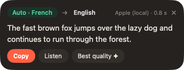
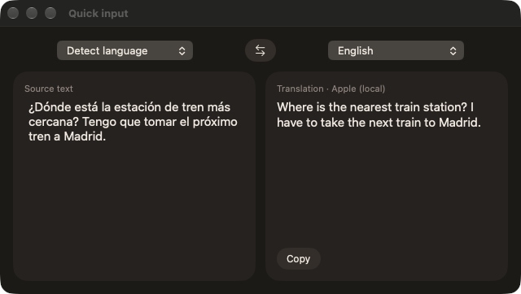
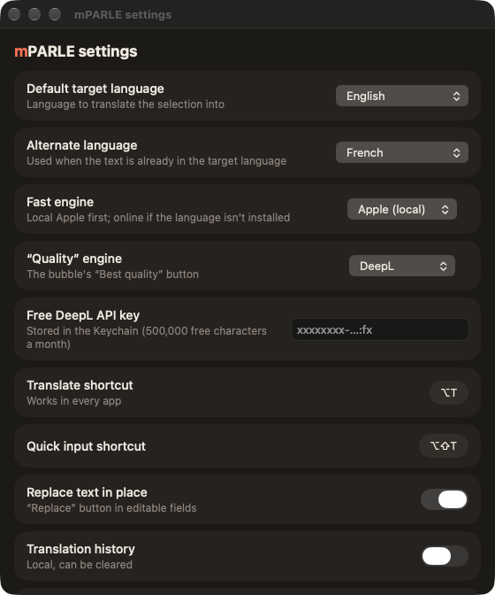

## About

**mPARLE** is a free macOS menu-bar app that translates any selected text, in any app, with one shortcut (⌥T). Part of the DESKTOP MAC TOOLKIT. Authors: Starbudweiser & Claude Code (Anthropic). MIT License. Provided as is, without warranty; inspired by Mate Translate, not affiliated with its authors.

## Features
- Select text anywhere, press ⌥T: a bubble appears next to the cursor with the translation (Replace in place, Copy, Listen).
- Quick input window (⌥⇧T), macOS Services entry, optional history.
- Engines: Apple Translation (local, offline, default), Google, DeepL (free API key), or a local model (OpenAI-compatible server such as Ollama).
- 4 interface languages (fr, en, es, it), light and dark, automatic updates. Requires macOS 26.

## Screenshots

## Support / Soutenir

This app is free. If it is useful to you, you can support the project (optional, no reward expected): [GitHub Sponsors](https://github.com/sponsors/starbudweiser).

Cette appli est gratuite. Si elle vous est utile, vous pouvez soutenir le projet (facultatif, sans contrepartie) : [GitHub Sponsors](https://github.com/sponsors/starbudweiser).
